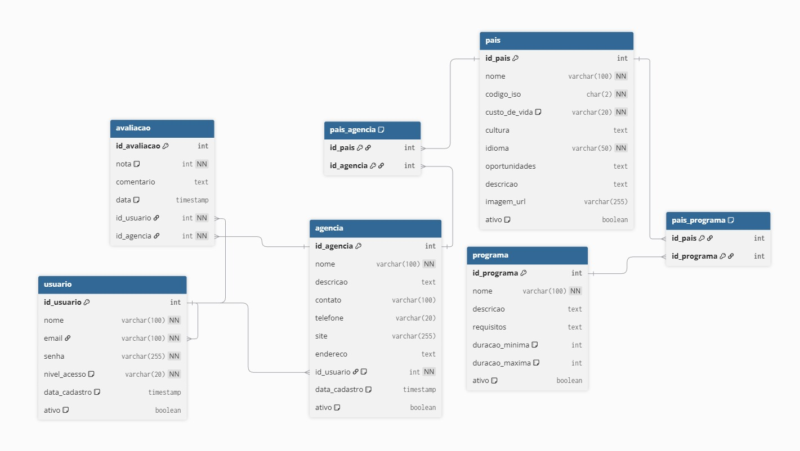
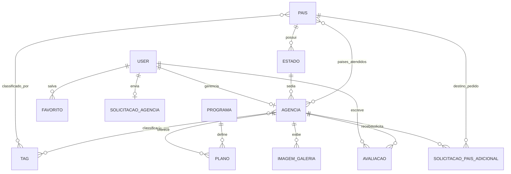
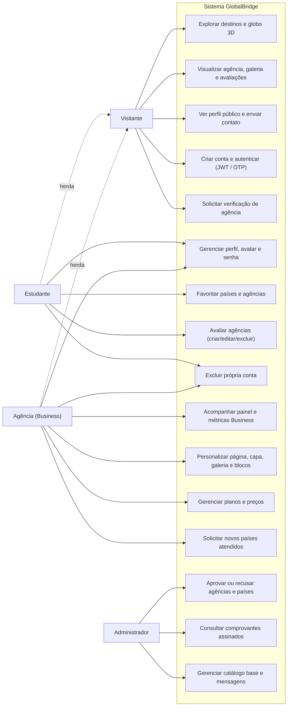
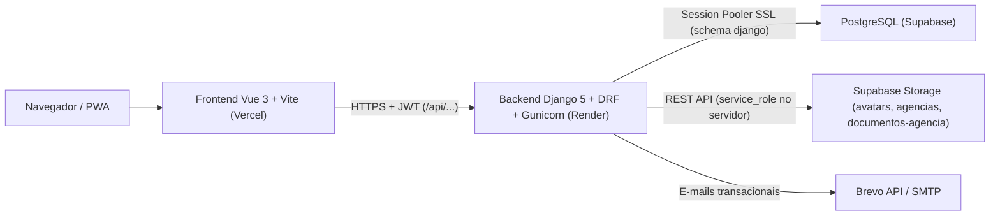

# GlobalBridge

**Projeto Integrador — Plataforma de Apoio ao Planejamento de Intercâmbios Internacionais**

A **GlobalBridge** tem como objetivo facilitar o processo de intercâmbio internacional, reunindo em um único portal informações confiáveis para estudantes interessados em estudar ou trabalhar no exterior. A plataforma reúne dados detalhados de **23 países** (custo de vida, idioma, cultura, universidades, cidades e programas), um **globo 3D interativo**, **26 agências verificadas** com páginas personalizáveis, avaliações de estudantes reais e uma área dedicada **GlobalBridge Business** para agências parceiras.

**Professor:** [Marco André Lopes Mendes](https://github.com/marrcandre)

**Equipe:**
- [Arthur Cândido](https://github.com/ArthurBenk)
- [Cauê Kreutz](https://github.com/CaueKreutz)
- [Filipe Bento](https://github.com/FilipeBento19)
- [Ijair Machado](https://github.com/youtario)

**Links do projeto:**
- **Documentação (este repositório):** [github.com/FilipeBento19/GlobalBridge](https://github.com/FilipeBento19/GlobalBridge)
- **Frontend:** [Repositório](https://github.com/globalbridgeorg/globalbridge-frontend) · [Aplicação publicada (Vercel)](https://globalbridge-gamma.vercel.app)
- **Backend (Django + DRF):** [Repositório](https://github.com/globalbridgeorg/globalbridge-backend) · [API publicada (Render)](https://globalbridge-backend-1.onrender.com/api/) · [Documentação Swagger / OpenAPI](https://globalbridge-backend-1.onrender.com/api/doc/) · [Django Admin](https://globalbridge-backend-1.onrender.com/admin/)

> **Nota sobre a hospedagem gratuita:** o backend roda no plano gratuito do Render, que hiberna após ~15 minutos sem acesso. Na primeira requisição após inatividade, o servidor pode levar alguns segundos para acordar.

---

# 1. Desenvolvimento

## 1.1 Modelo de Sistema

### Plataforma de intermediação e apoio ao planejamento de intercâmbios

O sistema desenvolvido no projeto é uma **plataforma digital de apoio ao planejamento de intercâmbios internacionais**, chamada **GlobalBridge**. O objetivo da plataforma é facilitar o acesso de estudantes e interessados em experiências internacionais a informações organizadas sobre países, programas de intercâmbio e agências verificadas.

A escolha desse sistema partiu da dificuldade real enfrentada por quem deseja estudar ou trabalhar no exterior: comparar destinos, entender custos de vida, identificar programas compatíveis e encontrar agências confiáveis. Grande parte dessas informações costuma ficar dispersa em dezenas de sites, blogs e redes sociais, tornando o início do planejamento confuso e demorado.

A GlobalBridge centraliza essa jornada em um único ambiente digital, oferecendo:
- **Para estudantes e visitantes:** exploração de destinos por região e em um **globo 3D interativo**, filtros por idioma/tags/região, páginas completas de países e agências (com galeria clicável, FAQ, equipe, certificações, planos e avaliações reais), sistema de favoritos e perfil público.
- **Para agências (GlobalBridge Business):** processo de solicitação e verificação com envio de comprovante, painel de métricas e completude da página, editor visual modular (banner/foto com ponto focal, galeria, blocos opcionais e ordenação de seções), gestão de planos/preços e solicitação de novos países atendidos.
- **Para administradores:** painel administrativo integrado (`/admin` no frontend + Django Admin nativo) para aprovar ou recusar solicitações de novas agências e países adicionais, além de gerenciar mensagens enviadas pelo formulário de contato.

---

# 2. Situação-Problema

## Introdução

O intercâmbio internacional tem se tornado cada vez mais comum entre estudantes e jovens profissionais que buscam novas oportunidades de aprendizado, imersão cultural e crescimento acadêmico ou profissional. Programas como **Study & Work**, **Au Pair**, cursos de idiomas, graduação e pós-graduação no exterior figuram entre as opções mais procuradas.

Entretanto, apesar do grande interesse, muitos estudantes enfrentam barreiras já nas primeiras etapas do planejamento — principalmente pela dispersão de informações e pela dificuldade de comparar destinos e agências de forma transparente.

## Situação-problema

Atualmente, quem planeja um intercâmbio costuma pesquisar manualmente em diversos sites de agências, vídeos, fóruns e redes sociais para descobrir custo de vida, idioma, cultura local, oportunidades de estudo/trabalho e requisitos básicos de cada país.

Esse cenário gera insegurança por três motivos principais:
1. **Informações fragmentadas e desatualizadas**, obrigando o estudante a cruzar múltiplas fontes para comparar países.
2. **Dificuldade de escolher agências confiáveis**, já que nem sempre há avaliações transparentes de outros estudantes ou comparação clara entre os programas oferecidos.
3. **Falta de filtros práticos**, dificultando relacionar o perfil e os objetivos do estudante aos destinos e programas mais compatíveis.

## Conclusão

Diante desse cenário, fica clara a necessidade de uma plataforma centralizada, confiável e interativa que conecte estudantes a informações estruturadas de destinos e a agências verificadas. A **GlobalBridge** simplifica essa jornada, apoiando decisões mais informadas e seguras antes do embarque.

---

# 3. Descrição da Proposta

A proposta do projeto é a **GlobalBridge**, uma aplicação web responsiva (com suporte a **PWA instalável**) dividida em frontend Vue 3 e backend API REST em Django + Django REST Framework, conectada a PostgreSQL e armazenamento de mídia em nuvem.

Entre os recursos entregues pela plataforma estão:
- **Catálogo de destinos:** 23 países organizados por região (América do Norte, América Latina, Europa, Ásia, Oceania e África), com custo de vida, idioma, cultura, universidades, cidades principais, tags e programas disponíveis.
- **Exploração interativa (`/mapview`):** globo 3D interativo com busca e filtros cruzados por região, tags, países e agências parceiras.
- **Páginas de agências personalizáveis (`/agencias/:id`):** cada agência possui identidade visual própria (hero em banner com ponto focal ou foto quadrada), galeria de fotos com visualização em tela cheia (lightbox), seção *"Como funciona"*, catálogo de planos/preços, equipe com fotos, certificações, perguntas frequentes (FAQ), vídeo, mapa, redes sociais, WhatsApp e avaliações de estudantes.
- **Avaliações reais e perfis públicos (`/usuarios/:username`):** estudantes autenticados avaliam agências (nota de 1 a 5 e comentário), podendo editar ou remover suas avaliações; os melhores depoimentos alimentam a seção *"Quem já foi"* na página inicial.
- **Área GlobalBridge Business (`/business` e `/business/editor`):** agências passam por verificação prévia (`/business/solicitar`), acompanham o status em `/business/analise` e, após aprovação, gerenciam métricas, ranking no país, completude da página, planos, galeria, países atendidos e layout modular.
- **Moderação administrativa (`/admin` e Django Admin):** análise de comprovantes com URLs assinadas temporárias, aprovação/recusa de novas agências e países adicionais com notificação por e-mail e leitura de mensagens do formulário `/contato`.

---

# 4. Modelagem de Dados

## 4.1 Modelo Conceitual Inicial (MER)



## 4.2 Entidades Implementadas no Backend (Django ORM / PostgreSQL)

Com a evolução do projeto (incluindo verificação de agências, editor de blocos, favoritos, login por código e contato), a modelagem implementada em `core/models/` conta com as seguintes tabelas no schema isolado `django`:

| Entidade (`Model`) | Descrição |
| :--- | :--- |
| `User` | Usuários do sistema (`estudante` ou `agencia`), autenticação por e-mail, `username` único para perfil público, `avatar`, `is_staff` / `is_superuser`. |
| `Pais` | Destinos disponíveis (`nome`, `nome_ingles`, `codigo_iso`, `regiao`, `custo_de_vida`, `idioma`, `cultura`, `descricao`, `imagem_url`, `intercambistas`, `universidades`, `ativo`) + M2M com `Tag`. |
| `Estado` | Estados/regiões e `cidade_principal` vinculados a cada `Pais`. |
| `Tag` | Marcadores de filtragem por `categoria`, `valor` e `label`, associados a `Pais` e `Agencia`. |
| `Agencia` | Agências verificadas (`nome`, `descricao`, `como_funciona`, `contato`, `telefone`, `site`, `endereco`, `ativo`, `id_estado`, `usuario`, `imagem_capa` + foco X/Y, `layout` JSON e `conteudo_blocos` JSON) + M2M com `Pais` (`paises_atendidos`) e `Tag`. |
| `ImagemGaleria` | Fotos individuais da galeria de cada `Agencia`, com ordenação (`ordem`). |
| `Programa` | Catálogo compartilhado de tipos de intercâmbio (`nome`, `descricao`, `duracao_min`, `duracao_max`). |
| `Plano` | Oferta concreta de um `Programa` por uma `Agencia`, com `preco`, `descricao` e itens inclusos (`inclui`). |
| `Avaliacao` | Nota (1 a 5) e `comentario` de um `User` sobre uma `Agencia` (única por par usuário + agência). |
| `Favorito` | Lista de países ou agências favoritados por cada `User` (`tipo`, `objeto_id`, `criado_em`). |
| `SolicitacaoAgencia` | Pedido de entrada como conta Business (`dados da agência`, `responsável`, `documento` comprobatório em bucket privado, `status`, `motivo_recusa`, vínculo com `usuario_criado` e `agencia_criada`). |
| `SolicitacaoPaisAdicional` | Pedido de uma `Agencia` já aprovada para passar a atender um novo `Pais`, sujeito à aprovação administrativa. |
| `MensagemContato` | Mensagens enviadas pelo formulário público `/contato` (`publico`, `nome`, `email`, `nome_agencia`, `assunto`, `mensagem`, `lida`). |
| `CodigoLogin` / `CodigoVerificacaoEmail` | Códigos temporários de 6 dígitos para login sem senha (OTP) e verificação de e-mail. |



---

# 5. Regras de Negócio

- **RN001 — Cadastro de País:** Um país só pode ser cadastrado com nome, código ISO, custo de vida, idioma, cultura e descrição válidos.
- **RN002 — Gestão do Catálogo Base:** Apenas administradores (`is_staff`) podem criar, editar ou remover países, estados, tags e programas compartilhados.
- **RN003 — Verificação Prévia de Agências:** Uma agência não pode ser criada diretamente pela API pública; ela deve enviar uma solicitação com documento comprobatório (`/business/solicitar`), que só gera uma `Agencia` ativa após aprovação administrativa.
- **RN004 — Países Atendidos sob Aprovação:** Uma agência aprovada só aparece na listagem dos países em que atua; para incluir novos destinos, envia uma solicitação de país adicional sujeita à moderação.
- **RN005 — Integridade de Avaliações:** A nota de uma avaliação deve estar entre **1 e 5**, e cada usuário pode manter apenas **uma avaliação por agência** (novos envios atualizam a avaliação anterior, evitando manipulação de média).
- **RN006 — Propriedade de Edição:** Usuários comuns só podem editar/excluir o próprio perfil, favoritos e avaliações; contas Business só podem alterar dados, layout, capa, galeria e planos da **própria** agência, sem permissão para alterar `usuario`, `ativo` ou escalar privilégios (`is_staff`/`is_superuser`).
- **RN007 — Exibição de Catálogo Ativo:** Somente países e agências com `ativo = True` são exibidos nas listagens públicas (catálogo, mapa 3D, páginas de destino e depoimentos da home).
- **RN008 — Integridade Referencial:** Países vinculados a solicitações ou dados ativos não podem ser removidos de forma inconsistente (`on_delete=PROTECT` nas solicitações); ao excluir uma conta Business, a agência vinculada também é removida para não deixar registros órfãos.
- **RN009 — Proteção de Documentos Sensíveis:** Comprovantes enviados por agências são armazenados em bucket privado (`documentos-agencia`) e acessados apenas por administradores via URL assinada com expiração temporária (300 s), validando que o caminho pertence a uma solicitação real.
- **RN010 — Privacidade de Dados Públicos:** Perfis públicos (`/usuarios/:username`) nunca expõem e-mail, permissões internas ou dados sensíveis de conta.

---

# 6. Requisitos Funcionais

## Níveis de acesso
- **Visitante:** navega pelo catálogo público, globo 3D, páginas de países, páginas de agências, perfis públicos e envia mensagens de contato ou solicitação de conta Business.
- **Estudante (`estudante`):** todos os acessos de visitante, além de gerenciar perfil/avatar/senha, salvar favoritos, criar/editar/excluir suas próprias avaliações e excluir sua conta.
- **Agência (`agencia` / Business):** acompanha análise da solicitação e, após aprovação, acessa o painel de métricas, edita dados institucionais, personaliza o layout/blocos/capa/galeria da página, gerencia planos e solicita novos países atendidos.
- **Administrador (`is_staff` / `is_superuser`):** acessa `/admin` (painel web) e Django Admin para aprovar/recusar solicitações de agências e países adicionais, consultar comprovantes, gerenciar mensagens de contato e administrar o catálogo base.

## Entradas e Gestão de Contas
- **RF001 — Cadastro de Estudante:** permite ao visitante criar conta com nome, e-mail e senha (mínimo 8 caracteres), recebendo tokens JWT de acesso.
- **RF002 — Autenticação (Senha e Código OTP):** permite login por e-mail/senha (`POST /api/token/`) ou por código temporário de 6 dígitos enviado por e-mail (`/api/auth/codigo/`), com opção *"Manter conectado"* e renovação automática de token (`/api/token/refresh/`).
- **RF003 — Recuperação e Alteração de Senha:** permite solicitar link de redefinição por e-mail (`/esqueci-senha` e `/redefinir-senha`) e alterar a senha estando autenticado (`/profile`).
- **RF004 — Edição de Perfil, Avatar e Exclusão de Conta:** permite atualizar nome, fazer upload de foto de perfil (armazenada no Supabase Storage) e excluir permanentemente a conta (`DELETE /api/usuarios/me/`).
- **RF005 — Formulário de Contato:** permite a estudantes e agências enviarem mensagens pelo formulário `/contato`, armazenadas para acompanhamento administrativo.

## Catálogo, Exploração e Interações do Estudante
- **RF006 — Página Inicial com Estatísticas e Depoimentos Reais:** exibe indicadores calculados em tempo real do banco (`/api/estatisticas/`), destinos mais procurados e depoimentos reais de estudantes na seção *"Quem já foi"* (`/api/avaliacao/depoimentos/`).
- **RF007 — Listagem e Detalhamento de Países:** exibe países por região (`/destinos`, `/regiao/:regiao`) e página completa de cada destino (`/pais/:id`) com custo de vida, cultura, idioma, cidades, programas e agências atuantes.
- **RF008 — Globo 3D Interativo e Filtros (`/mapview`):** permite explorar destinos em um globo 3D interativo e filtrar países/agências por região, idioma e tags.
- **RF009 — Página Pública da Agência (`/agencias/:id`):** exibe a página conforme o layout personalizado pela agência (hero em banner ou foto, descrição, *"Como funciona"*, galeria com lightbox em tela cheia, catálogo de planos, equipe com fotos, certificações, FAQ, vídeo, localização, redes sociais, WhatsApp e avaliações).
- **RF010 — Avaliação de Agências:** permite ao estudante criar, atualizar ou remover sua avaliação (nota 1 a 5 e comentário) e consultar o histórico em *"Minhas avaliações"*.
- **RF011 — Favoritos:** permite ao usuário autenticado favoritar e desfavoritar países e agências, listando-os em seu perfil.
- **RF012 — Perfil Público (`/usuarios/:username`):** exibe o perfil público de estudantes (avaliações e estatísticas) ou de contas de agências (resumo e link para a página da agência).

## Área GlobalBridge Business (Agências)
- **RF013 — Solicitação de Conta Business (`/business/solicitar`):** permite enviar pedido de verificação com dados da agência, países atendidos, responsável, senha e upload do documento comprobatório, acompanhando o status em `/business/analise`.
- **RF014 — Painel de Métricas da Agência (`/business`):** exibe nota média, distribuição de notas, total de favoritos (geral e últimos 30 dias), ranking dentro do país sede, indicador de completude da página, avaliações e favoritos recentes (`/api/agencia/:id/painel/`).
- **RF015 — Edição de Dados Institucionais e Planos:** permite à agência atualizar informações de contato/descrição e criar, editar ou remover seus próprios planos (`Plano`) com programa, preço, descrição e itens inclusos.
- **RF016 — Editor Modular de Página (`/business/editor`):** permite reordenar seções, trocar variantes (ex.: hero banner vs. foto), subir imagem de capa e ajustar ponto focal (X/Y), gerenciar fotos da galeria e preencher blocos opcionais (equipe com fotos, certificações, FAQ, vídeo, mapa, redes sociais e WhatsApp) com prévia em tempo real.
- **RF017 — Solicitação de Países Adicionais:** permite à agência aprovada solicitar atuação em novos países.

## Administração e Moderação
- **RF018 — Painel Administrativo (`/admin`):** permite a administradores visualizar solicitações pendentes de agências e países adicionais, abrir comprovantes via URL assinada temporária, aprovar ou recusar pedidos (com motivo e envio de e-mail) e marcar mensagens de contato como lidas.
- **RF019 — Administração Completa (Django Admin `/admin/`):** disponibiliza interface administrativa nativa do Django para gestão completa de países, estados, tags, programas, planos, agências, solicitações, usuários e mensagens.

---

# 7. Requisitos Não Funcionais

- **RNF01 — Arquitetura Desacoplada:** comunicação entre frontend e backend realizada via API REST JSON (padrão HTTP + OpenAPI 3), com documentação interativa em `/api/doc/` (`drf-spectacular`).
- **RNF02 — Stack Frontend:** desenvolvido em **Vue 3** (Composition API), **Vue Router**, **Vite**, **Globe.gl / D3 / TopoJSON** (mapa 3D), **GSAP / Lenis** (animações com respeito a `prefers-reduced-motion`), **Flaticon UIcons** e suporte a **PWA** (`vite-plugin-pwa`).
- **RNF03 — Stack Backend:** desenvolvido em **Python 3** com **Django 5**, **Django REST Framework**, **SimpleJWT**, **WhiteNoise** e **Gunicorn**.
- **RNF04 — Persistência e Isolamento de Banco de Dados:** banco relacional **PostgreSQL** hospedado no **Supabase**, conectado via Session Pooler com SSL obrigatório (`sslmode=require`) e tabelas do Django isoladas em schema dedicado (`DB_SCHEMA=django`) com usuário de menor privilégio (`django_app`).
- **RNF05 — Armazenamento de Mídia em Nuvem:** uploads de avatares, capas, galerias e comprovantes persistidos no **Supabase Storage** via backend customizado em Django (`core/storage.py`), com bucket privado e URLs assinadas para documentos comprobatórios.
- **RNF06 — Segurança e Controle de Acesso:** autenticação stateless via **JWT (Bearer)** com refresh automático, senhas com hash seguro do Django, validação de permissões por papel e por propriedade de recurso, `CORS_ALLOWED_ORIGINS` restrito ao domínio do frontend e proteção contra path traversal na assinatura de documentos.
- **RNF07 — Privacidade e Conformidade (LGPD):** suporte à exclusão permanente de conta e dados associados pelo próprio usuário, além de separação estrita entre dados públicos e privados nos serializers.
- **RNF08 — Responsividade e Acessibilidade:** interface adaptada para desktop, tablet e mobile, com navegação dedicada em telas menores, suporte a teclado (ex.: lightbox com `Escape`/setas), foco visível e landmarks semânticos.
- **RNF09 — Compatibilidade de Navegadores:** homologado para versões atuais de Google Chrome, Brave, Microsoft Edge, Mozilla Firefox e Safari.
- **RNF10 — Testabilidade e Qualidade:** cobertura de testes automatizados no backend (`python manage.py test core`) validando catálogo público, autenticação JWT, permissões de negócio, CRUD de planos, fluxo de solicitação/aprovação administrativa e integração de storage.
- **RNF11 — Disponibilidade e Implantação Contínua:** deploy automatizado via GitHub — frontend na **Vercel** e backend no **Render** (com `build.sh` executando `ensure_schema`, `collectstatic`, `migrate` e `seed_globalbridge --if-empty`).

---

# 8. Diagrama de Casos de Uso



---

# 9. Arquitetura, Tecnologias e Execução Local

## 9.1 Arquitetura de Produção



## 9.2 Principais Endpoints da API

A especificação interativa completa está disponível em [Swagger UI (`/api/doc/`)](https://globalbridge-backend-1.onrender.com/api/doc/):
- `GET /api/estatisticas/` — métricas agregadas da plataforma
- `GET /api/paises/` · `GET /api/paises/mais-procurados/` · `GET /api/paises/{id}/` — destinos
- `GET /api/agencia/` · `GET /api/agencia/{id}/` · `PATCH /api/agencia/{id}/` · `GET /api/agencia/{id}/painel/` — agências e painel Business
- `PATCH /api/agencia/{id}/capa/` · `POST/DELETE /api/agencia/{id}/galeria/` — capa e galeria
- `GET /api/programa/` · `GET/POST/PATCH/DELETE /api/plano/` — programas e planos
- `GET /api/avaliacao/depoimentos/` · `GET /api/avaliacao/minhas/` · `POST/PATCH/DELETE /api/avaliacao/` — avaliações
- `GET/POST/DELETE /api/favoritos/` — favoritos
- `POST /api/contato/` — envio de mensagens de contato
- `POST /api/registro/` · `POST /api/token/` · `POST /api/token/refresh/` · `GET/PATCH/DELETE /api/usuarios/me/` · `POST /api/usuarios/me/senha/` · `GET /api/usuarios/u/{username}/` — contas e autenticação
- `POST /api/solicitacoes-agencia/` · `GET /api/solicitacoes-agencia/minha/` — verificação de agências
- `GET /api/admin-painel/dados/` · `POST /api/admin-painel/solicitacoes-agencia/{id}/aprovar/` — moderação administrativa (`is_staff`)

## 9.3 Como Executar Localmente

### Backend (Django + DRF)
```bash
git clone https://github.com/globalbridgeorg/globalbridge-backend.git
cd globalbridge-backend
git checkout dev

python -m venv .venv
# Windows: .venv\Scripts\activate  |  Linux/Mac: source .venv/bin/activate
pip install -r requirements.txt

python manage.py migrate
python manage.py seed_globalbridge
python manage.py test core
python manage.py runserver
```
> Sem `DATABASE_URL`, o backend roda automaticamente em SQLite local (`http://127.0.0.1:8000`).

### Frontend (Vue 3 + Vite)
```bash
git clone https://github.com/globalbridgeorg/globalbridge-frontend.git
cd globalbridge-frontend
git checkout dev

npm install
npm run dev
```
> Em desenvolvimento local, o Vite faz proxy automático de `/api` e `/media` para `http://127.0.0.1:8000`.

## 9.4 Conta de Demonstração (Avaliação)

Para testar rapidamente as áreas **Business** (`/business`, `/business/editor`) e **Admin** (`/admin` e `/admin/` do Django):
- **E-mail:** `demo@globalbridge.com`
- **Senha:** `GlobalBridge2026!`
